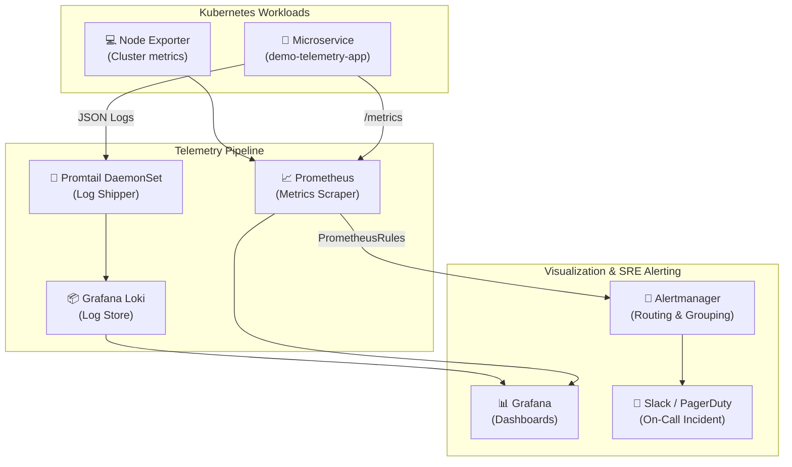

# Kubernetes Observability Stack 📊🔍

> **One-Command Enterprise K8s Observability** — Prometheus, Grafana, Loki, Alertmanager, and Promtail with production-grade dashboards, SRE golden signal alerts, and runbook integration.

[](https://kubernetes.io/)
[](https://prometheus.io/)
[](https://grafana.com/)
[](https://grafana.com/oss/loki/)
[](https://helm.sh/)

---

## 📖 Overview

A battle-tested, out-of-the-box observability platform designed for Kubernetes clusters (local `kind` / `minikube` or production `EKS` / `GKE`):
- 📈 **Metrics Collection**: Prometheus with 15-day retention and ServiceMonitor CRD support.
- 📜 **Centralized Logging**: Grafana Loki + Promtail daemonset parsing JSON container logs.
- 🚨 **Intelligent Alerting**: Alertmanager with severity routing, Slack notifications, and runbook links.
- 📊 **Curated Dashboards**: Pre-baked Grafana dashboards for Cluster Health, Node Utilization, and Application Golden Signals (Latency, Traffic, Errors, Saturation).
- 🧪 **Live Demo Telemetry Service**: Instrument Python microservice emitting real-time metrics and logs to validate the pipeline.

---

## 🏗️ Architecture



---

## 🚀 Quick Start

### 1. Deploy the Complete Stack

```bash
# Clone the repository
git clone https://github.com/TarunKumarPardeshi/k8s-observability-stack.git
cd k8s-observability-stack

# Deploy Prometheus, Grafana, Loki, Alertmanager
make up
```

### 2. Deploy Sample Microservice & Generate Load

```bash
# Deploys demo app with /metrics endpoint and structured logs
make demo
```

### 3. Access UIs

```bash
# Port-forward Grafana (admin / admin)
make port-forward-grafana
# Open http://localhost:3000

# Port-forward Prometheus
make port-forward-prometheus
# Open http://localhost:9090
```

### 4. Teardown

```bash
make down
```

---

## 🚨 SRE Runbooks & Golden Signals

| Alert Name | Severity | Condition | Triage Runbook |
| :--- | :--- | :--- | :--- |
| `HighHttpErrorRate` | `critical` | 5xx Error Rate > 5% over 2m | 1. Check Grafana Golden Signals dashboard.<br>2. Query Loki logs `{app="demo-app"} \|= "ERROR"`.<br>3. Verify downstream database / cache connection pools. |
| `HighP99Latency` | `warning` | P99 Latency > 500ms over 5m | 1. Inspect Pod CPU/Memory limits.<br>2. Check for garbage collection pauses or thread pool starvation. |
| `PodCrashLooping` | `critical` | Restart count > 2 in 5m | 1. Run `kubectl describe pod <pod_name>` for termination exit codes (`OOMKilled` = 137).<br>2. Review `kubectl logs --previous <pod_name>`. |

---

## 📂 Repository Layout

```
├── helm/
│   └── values/
│       ├── prometheus.yaml         # Kube-Prometheus-Stack overrides & datasources
│       └── loki.yaml               # Loki storage & Promtail pipeline stages
├── manifests/
│   ├── alertmanager-config.yaml    # Alertmanager severity routing & Slack integration
│   └── prometheus-rules.yaml       # Recording rules & Golden Signal alerts
├── dashboards/
│   ├── golden-signals.json         # SRE Golden Signals Grafana dashboard
│   └── cluster-health.json         # Node and cluster resource dashboard
├── demo-app/
│   ├── app.py                      # Flask microservice with /metrics & JSON logs
│   ├── Dockerfile                  # Container definition
│   └── k8s.yaml                    # Deployment, Service & ServiceMonitor
├── Makefile                        # One-command operational workflows
└── README.md
```

---

## 👨‍💻 Author

**Tarun Kumar Pardeshi** — Cloud & DevOps Engineer
- GitHub: [@TarunKumarPardeshi](https://github.com/TarunKumarPardeshi)
